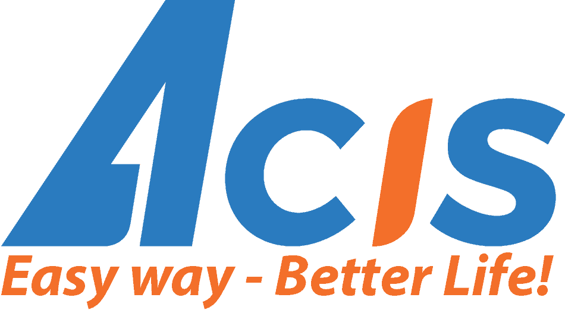
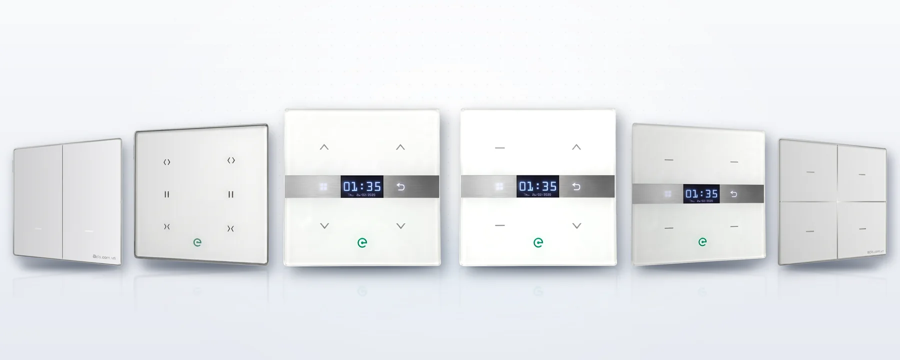
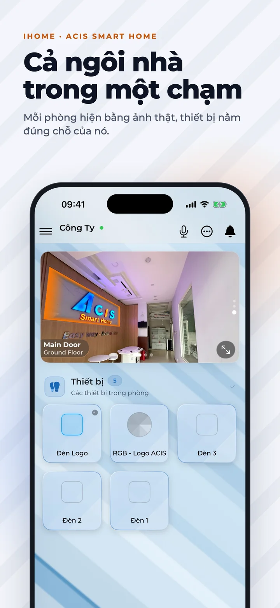
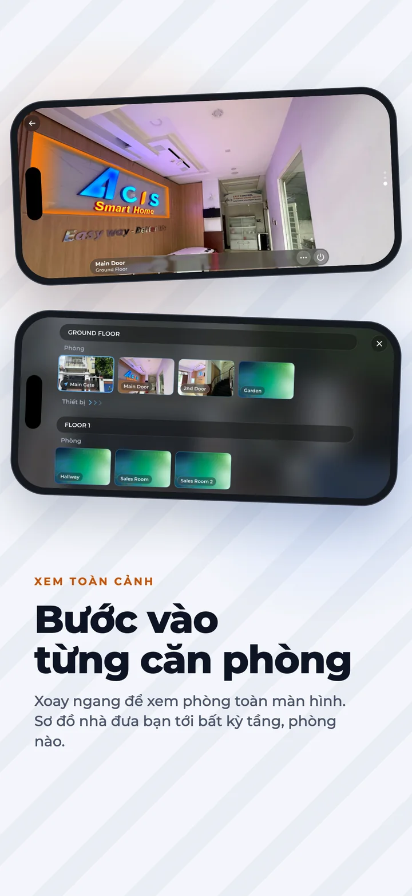
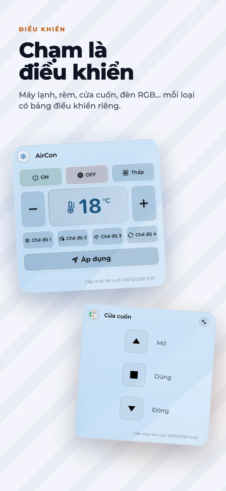

### Vietnamese-engineered smart home ecosystem — from hardware to app.

ACIS designs, builds and operates the full smart home stack in-house: touch switches, central controllers, 
sensors, wireless mesh firmware, the **iHome** app and the cloud behind it.

 

 

<picture>
  <source media="(prefers-color-scheme: dark)" srcset="assets/lineup-2026-front-dark.webp">
  
</picture>

The ACIS 2026 touch switch collection

---

## 🏠 About ACIS

For more than **14 years**, ACIS has been pioneering wireless smart home technology in Vietnam. We started as a research team born out of the **HCMUT Robocon** team, and chose early on to own every layer of the technology ourselves — hardware, firmware, software and the control platform — so that our systems are built for Vietnamese homes and Vietnamese buildings.

<table>
  <tr>
    <td align="center" width="25%"><h3>8,000+</h3>projects completed</td>
    <td align="center" width="25%"><h3>14+</h3>years in the market</td>
    <td align="center" width="25%"><h3>34</h3>provinces &amp; cities served</td>
    <td align="center" width="25%"><h3>3–5 years</h3>one-for-one warranty</td>
  </tr>
</table>

## 🧩 The ecosystem

| | Product | What it does |
|:-:|---|---|
| 🔲 | **Touch switches** | Ultra-thin tempered-glass panels that fit standard 220V wall boxes — no extra neutral wire needed. |
| 🧠 | **Central controllers** | The brain of the home: scenes, schedules and automation across every device. |
| 📡 | **Sensors** | Motion, presence, door and temperature/humidity sensors that drive lighting, climate and security. |
| 💡 | **Smart Lighting** | Deep lighting control, launched in alliance with **Rạng Đông**. |
| 📱 | **iHome app** | One app for every ACIS device — lighting, climate, curtains, cameras, security — anywhere. |
| 🔗 | **Integrations** | Cameras, Google, voice control, smart locks and other third-party devices. |

### Core technology

- **Proprietary wireless mesh network** — AES-128 encrypted, up to 100 m per hop, through reinforced concrete floors.
- **Peer-to-peer device interaction** — switches, scenes and remotes keep working even without a central controller.
- **Works offline** — schedules keep running when the internet goes down.
- **Vietnamese cloud &amp; Vietnamese voice control** — built for Vietnamese homes, hosted in Vietnam.

## 📱 iHome

<table>
  <tr>
    <td align="center" width="33%">
      <picture>
        <source media="(prefers-color-scheme: dark)" srcset="assets/ihome-31-01-dark.webp">
        
      </picture>
    </td>
    <td align="center" width="33%">
      <picture>
        <source media="(prefers-color-scheme: dark)" srcset="assets/ihome-31-02-dark.webp">
        
      </picture>
    </td>
    <td align="center" width="33%">
      <picture>
        <source media="(prefers-color-scheme: dark)" srcset="assets/ihome-31-03-dark.webp">
        
      </picture>
    </td>
  </tr>
</table>

  <a href="https://apps.apple.com/vn/app/ihome-acis/id1354811832"><b>Download on the App Store</b></a>
  &nbsp;·&nbsp;
  <a href="https://play.google.com/store/apps/details?id=com.acis.ihome"><b>Get it on Google Play</b></a>

## 🛠️ What we build with

  
  
  
  
  
  
  
  
  
  
  
  
  
  
  

In-house hardware design &amp; embedded firmware · native iOS &amp; Android apps · cross-platform desktop tools · .NET APIs · Next.js websites.

## 🗓️ Milestones

| Year | Milestone |
|:----:|---|
| **2004** | Research roots in the HCMUT Robocon team — automation and AI. |
| **2012** | ACIS founded. Launch of **Power Control** for whole-home energy management. |
| **2014** | **EasyControl** — proprietary wireless Mesh Network. |
| **2016** | **EasyHome** — peer-to-peer interaction, no central processor required. |
| **2020** | Ecosystem opens to third parties: cameras, Google, voice control, smart locks. |
| **2023** | **Smart Lighting**, launched in alliance with Rạng Đông. |
| **2026** | A brand-new generation of ACIS switches — simpler, more modern, made to blend in. |

<b>🏆 Awards &amp; recognition</b>

 

- **2014** — Merit for science &amp; technology research — *Saigon Hi-Tech Park Management Board*
- **2014** — Title &amp; commemorative medal — *Vietnam Intellectual Property Association*
- **2014** — "Trusted Product" certification for EasyControl
- **2014** — Software copyright registration for Esmart — *Copyright Office of Vietnam*
- **2015** — Graduated from the Hi-Tech Business Incubator — *SHTP-IC*
- **2016** — Merit for the EasyControl R&amp;D team — *Saigon Hi-Tech Park Management Board*
- **2016** — Top 100 Reputable, Safe &amp; Quality Products and Services — *VietNam Business Council Network*
- **2017** — Quality Innovation Index certification — *Global GTA / APQ Union*

<b>🇻🇳 Giới thiệu bằng tiếng Việt</b>

 

**ACIS — Công nghệ Việt. Kiến tạo cho cách sống hiện đại.**

Hơn 14 năm tiên phong công nghệ nhà thông minh không dây tại Việt Nam, ACIS làm chủ 100% từ phần cứng đến phần mềm để kiến tạo những hệ thống được thiết kế cho người Việt và những công trình Việt.

- **Công tắc cảm ứng** mặt kính cường lực siêu mỏng — lắp vừa đế âm tường 220V tiêu chuẩn, không cần đi thêm dây trung tính.
- **Bộ trung tâm &amp; cảm biến** — kịch bản, hẹn giờ và tự động hóa chạy ngay tại nhà.
- **Ứng dụng iHome** — điều khiển chiếu sáng, điều hòa, rèm cửa, camera, an ninh trong một ứng dụng.
- **8.000+ dự án** đã hoàn thành tại **34 tỉnh thành**, bảo hành 1 đổi 1 từ 3–5 năm, hotline lắp đặt &amp; sửa chữa 24/7.

👉 Tìm hiểu thêm tại [acis.com.vn](https://acis.com.vn) · Trở thành đối tác: [partner.acis.com.vn](https://partner.acis.com.vn) · Tuyển dụng: [career.acis.com.vn](https://career.acis.com.vn)

## 🤝 Work with us

- **Homeowners &amp; designers** — explore products and projects at [acis.com.vn](https://acis.com.vn)
- **Dealers &amp; installers** — join our nationwide network via [partner.acis.com.vn](https://partner.acis.com.vn)
- **Engineers** — build the smart home of Vietnam with us: [career.acis.com.vn](https://career.acis.com.vn)
- **Existing customers** — guides, manuals and help at [support.acis.com.vn](https://support.acis.com.vn)

## 📬 Contact

<table>
  <tr>
    <td>📍 <b>Head office</b></td>
    <td>No. 36, Street 15, Quarter 5, Hiep Binh Chanh Ward, Thu Duc City, Ho Chi Minh City, Vietnam</td>
  </tr>
  <tr>
    <td>✉️ <b>Email</b></td>
    <td><a href="mailto:biz@acis.com.vn">biz@acis.com.vn</a></td>
  </tr>
  <tr>
    <td>📞 <b>Hotline / Zalo</b></td>
    <td><a href="tel:+84902673389">0902 673 389</a> · <a href="https://zalo.me/0902673389">Chat on Zalo</a></td>
  </tr>
</table>

---

  <b>ACIS</b> · Easy way — Better life! · © 2012–2026 ACIS. Made in Vietnam 🇻🇳

